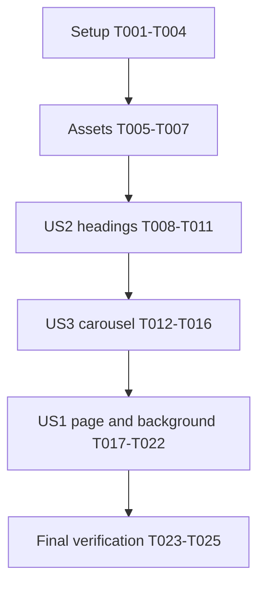

# Tasks: React Portfolio Main Page

**Input**: [plan.md](plan.md), [spec.md](spec.md), [research.md](research.md), [data-model.md](data-model.md), [component contracts](contracts/components.md), [quickstart.md](quickstart.md).

**Execution order**: Setup → assets → headings (US2, P1) → carousel (US3, P2) → main page (US1, P1) → final validation. Story IDs/priorities remain those in the specification; the user's explicit components-before-page requirement overrides priority-only scheduling.

**Verification**: Browser scenarios are required checkpoints, not new permanent automated test suites. No test framework was added. Type-check/build and actual production preview passed after integration; checkmarks record completed implementation and exercised checks.

**Format**: `- [ ] T### [P?] [US#?] Action with exact paths`. `[P]` means independently executable with other identified work once its stated prerequisites are complete; it does not remove phase barriers.

## Phase 1: Setup

**Goal**: Add the requested stack in place without replacing existing project files.

- [X] T001 Create `package.json` for React/React DOM, TypeScript, Vite, React/Tailwind Vite plugins, matching React types, and local JetBrains Mono dependencies per `specs/001-react-portfolio/plan.md`; add `dev`, `typecheck`, `build`, and `preview` scripts, install compatible packages, and commit resolved versions to `package-lock.json` without using an overwriting scaffold.
- [X] T002 [P] Configure React and Tailwind Vite plugins in `vite.config.ts` after T001; do not introduce routing, a server framework, or a legacy Tailwind/PostCSS configuration.
- [X] T003 [P] Configure strict TypeScript in `tsconfig.json` and asset typings in `src/vite-env.d.ts` after T001, using DOM libraries, `react-jsx`, bundler resolution, `allowJs: true`, `checkJs: false`, and `noEmit: true` so `ascii-metaballs.js` can be imported unchanged.
- [X] T004 Add Tailwind import, locally bundled JetBrains Mono 400, source colors, body isolation, and transparent root/page defaults in `src/styles.css`; add dependency/build exclusions to `.gitignore` without ignoring tracked source or replacing existing rules.

## Phase 2: Foundational Assets

**Goal**: Resolve actual reference assets before component work. Figma file key is `8Qb17gg8m0JsxFuEScxxsG`; node/export handling is in `research.md`.

- [X] T005 [P] Export Figma ASCII frames `3:83` and `8:2` to `src/assets/figma/projects-ascii.svg` and `src/assets/figma/art-ascii.svg`; preserve outlined artwork and local light highlight fills, source proportions, and overflow bounds rather than embedding a blue page background.
- [X] T006 [P] Export arrow nodes `11:38`/`11:36` to `src/assets/figma/previous.svg` and `src/assets/figma/next.svg`, download node `11:24` imageRef `40331509126c44f331df7fa91a5ada83ae520a36` to `src/assets/figma/practice-axe.png`, and move `specs/001-react-portfolio/design/project-title.svg` to `src/assets/figma/project-title.svg` without retaining duplicate copies; preserve arrow directions and image crop metadata.
- [X] T007 [P] Export wordmark `1:4`, greeting group `3:22`, and repeated strip `3:21` to `src/assets/figma/wordmark.svg`, `src/assets/figma/greeting.svg`, and `src/assets/figma/greeting-strip.svg`; retain outlined mixed-font lettering and original highlight fills.

**Checkpoint**: Actual assets are local and usable. Do not substitute recreated artwork, invented projects, screenshots of whole components, or an unverified MS W98 UI font.

## Phase 3: User Story 2 — Read Consistent Section Headings (P1)

**Goal**: Complete the two heading components before main-page assembly.

**Independent check**: Render both in a temporary entry at desktop/mobile widths; compare with Figma `10:19`/`10:13`, inspect heading names, and confirm artwork is not separately announced.

- [X] T008 [P] [US2] Implement `src/components/H1.tsx` with readonly `id`, `label`, and `artworkSrc` props, native readable `h1`, decorative artwork with empty alternative, centered reference layout, 20-pixel top padding, 8-pixel gap, and proportional artwork scaling without clipping.
- [X] T009 [P] [US2] Implement `src/components/H2.tsx` with readonly `id`, `label`, `artworkSrc`, and `description` props, native `h2`/paragraph, decorative artwork, centered reference layout, 20-pixel top padding, 10-pixel gaps, and description wrapping at narrow widths.
- [X] T010 [US2] Create removable `component-preview.html` and `src/dev/component-preview.tsx` after T008–T009 to render both components with actual artwork and reference labels/descriptions; import `src/styles.css`, use React Strict Mode, and serve this entry through Vite without creating `PortfolioPage` yet.
- [X] T011 [US2] Launch the development server and inspect `component-preview.html` at 1280 × 832 and 375 × 812 per `specs/001-react-portfolio/quickstart.md`; confirm heading artwork/highlights, typography, labels, spacing, accessible heading names, and zero horizontal overflow, fixing defects in `src/components/H1.tsx` or `src/components/H2.tsx` before proceeding.

**Checkpoint**: Both heading components work independently; US2 satisfies FR-003/FR-004 and its accessibility/responsive share of FR-007/FR-008.

## Phase 4: User Story 3 — Browse Project Artwork (P2)

**Goal**: Complete and verify `ProjectCarousel` before constructing the main page.

**Independent check**: Use real one-item content and distinct temporary multiple-item fixtures, plus empty/broken-image cases. Verify selection coherence, boundaries, keyboard/pointer interaction, focus, and mobile fit.

- [X] T012 [US3] Define readonly `Project` in `src/types/project.ts` with `id`, `title`, `titleImageSrc`, `imageSrc`, `imageAlt`, and `description` according to `specs/001-react-portfolio/data-model.md`; do not add runtime validation, persistence, or a fetch layer.
- [X] T013 [US3] Author `src/data/projects.ts` with only the supplied `practice_axe.fbx` record, actual imported title/image assets, a descriptive image alternative, and the reference description; keep IDs unique and the exported collection readonly.
- [X] T014 [US3] Implement `src/components/ProjectCarousel.tsx` using readonly project props, one local active index, functional updates, coherent selected fields, native labeled previous/next buttons, visible focus, concise polite selection status, both-direction wrapping, disabled zero/one-item controls, absent empty card, and the reference desktop/responsive geometry; no autoplay or carousel dependency.
- [X] T015 [US3] Extend `src/dev/component-preview.tsx` with separately remounted zero-, one-, and multi-item carousel cases and a broken-image case; use at least two distinguishable temporary records, including distinct title artwork and image alternatives, without adding fixture projects to `src/data/projects.ts`.
- [X] T016 [US3] Exercise the carousel in `component-preview.html` with pointer and Tab/Enter/Space at both target widths per `specs/001-react-portfolio/quickstart.md`; verify both wrap boundaries, synchronized title/image/description, disabled/empty states, focus retention, accessible status, broken-image alternative, and no overflow, correcting `src/components/ProjectCarousel.tsx` before page assembly.

**Checkpoint**: All three requested components are built and independently verified. US3 satisfies FR-005/FR-006, SC-003, and its FR-007/FR-008 share. Only now begin US1.

## Phase 5: User Story 1 — View the Designed Portfolio (P1)

**Goal**: Compose “MacBook Air - 1” using the verified components while retaining the existing ASCII metaball background.

**Independent check**: Open the composed page and compare with Figma at 1280 × 832, then resize to mobile and exercise background motion/lifecycle behavior.

- [X] T017 [P] [US1] Implement `src/components/MetaballBackground.tsx` as an effect-only component returning the disposer from `mountAsciiMetaballs(document.body)`; import `ascii-metaballs.js` unchanged and add no animation state, listeners, or new renderer settings.
- [X] T018 [P] [US1] Construct `src/pages/PortfolioPage.tsx` from greeting, wordmark, introduction, greeting strip, verified `H1`, verified `H2`, and verified `ProjectCarousel` with the sole real project; preserve reference content, accessible equivalents for outlined lettering, left-aligned header, centered sections, 64-pixel desktop outer padding, 1152-pixel content width, 20-pixel main gaps, and natural vertical scrolling.
- [X] T019 [US1] Compose `src/App.tsx` with exactly one `MetaballBackground` beside `PortfolioPage`, and create the React Strict Mode entry in `src/main.tsx` importing `src/styles.css`; do not introduce a router or another canvas mount.
- [X] T020 [US1] Cut over the existing `index.html` to the React root/module entry and remove its obsolete inline background mount and migrated style block; preserve document metadata, body isolation through `src/styles.css`, transparent foregrounds, and the unchanged `ascii-metaballs.js` implementation.
- [X] T021 [US1] Inspect the actual main page at 1280 × 832 and 375 × 812 against `specs/001-react-portfolio/design/main-page.png`; confirm all seven content groups, artwork/copy, reference spacing, visible background, complete vertically scrollable carousel, readable mobile layout, and zero horizontal overflow, fixing layout defects in `src/pages/PortfolioPage.tsx` and the owning components.
- [X] T022 [US1] Exercise pointer response, resize, reduced-motion initial load/toggling, and Strict Mode/unmount/remount through a temporary extension to `src/dev/component-preview.tsx`; observe one mounted canvas and none after cleanup, resumed motion without duplication, and unobstructed controls, correcting only the React integration in `src/components/MetaballBackground.tsx`, `src/App.tsx`, or `src/styles.css` as needed.

**Checkpoint**: US1 satisfies FR-001/FR-002 and SC-001/SC-002; desktop/mobile checks finish SC-004 across the composed experience. Do not replace the renderer's blue base or Figma's local highlight bars.

## Phase 6: Final Verification and Delivery

- [X] T023 Remove the temporary `component-preview.html`, `src/dev/component-preview.tsx`, and any temporary fixture assets after their browser checks pass; update moved-title links in `specs/001-react-portfolio/plan.md` and `specs/001-react-portfolio/research.md` to `src/assets/figma/project-title.svg` without leaving stale references or duplicate files.
- [X] T024 Run `npm run typecheck` and `npm run build` once with the final `package.json`, then launch `npm run preview -- --host 127.0.0.1` and inspect the actual built page using `specs/001-react-portfolio/quickstart.md`; confirm font/artwork loading, background, controls, desktop/mobile fit, and no application console/network errors, retaining actual browser screenshots as evidence rather than reusing the Figma PNG.
- [X] T025 After successful smoke verification, write concise setup/run/build instructions in `README.md`, update `AGENTS.md` and `specs/001-react-portfolio/quickstart.md` from planned to actual tooling status, and record exercised scenarios, command results, screenshots, and any genuine limits in `specs/001-react-portfolio/quickstart.md`; mark only completed tasks in `specs/001-react-portfolio/tasks.md`.

## Dependencies and Execution Order

- T001 precedes T002/T003; T004 completes setup before component/browser work.
- T005/T006/T007 have separate output files and can run together after setup.
- T008/T009 can run together after foundation; T010 waits for both, T011 waits for the harness.
- T012 → T013 → T014 → T015 → T016 is the carousel sequence; it starts after the heading checkpoint in this task order.
- T017/T018 can run together only after T016; T019 waits for both, then T020 → T021 → T022.
- T023 → T024 → T025 runs after all story checks. A failed check requires fixing its actual cause and re-exercising the affected scenario before marking its task complete.
- No live collection-editing API, backend, deployment platform, additional projects, or permanent component gallery is part of this feature.

## Parallel Execution Examples

- **US2**: After T007, separate workers can implement `src/components/H1.tsx` (T008) and `src/components/H2.tsx` (T009); one integration owner handles the shared preview entry and browser check.
- **US3**: No within-story parallel slice is justified: the type/content/component/harness chain is sequential, and the preview entry is shared. Do not invent `[P]` work to split it.
- **US1**: After T016, implement `src/components/MetaballBackground.tsx` (T017) separately from `src/pages/PortfolioPage.tsx` (T018); integrate both in `src/App.tsx` only afterward.
- Shared `src/styles.css`, manifests, and preview entry have one owner. Delegated implementation workers skip build/lint/tests; final integration runs them once as specified.

## Implementation Strategy and Coverage

- **First useful increment**: US2's headings independently demonstrated after setup/assets. This is a checkpoint, not completion of the requested feature.
- **Minimum complete requested delivery**: All three components plus the main page, existing background, responsive/accessibility behavior, and final verification. Do not silently ship a US1-only subset or stop after a component checkpoint.
- **FR-001**: T007, T018, T021. **FR-002**: T017, T019–T022. **FR-003/FR-004**: T005, T008–T011.
- **FR-005/FR-006**: T006, T012–T016. **FR-007**: T008–T011, T014–T016, T017–T022. **FR-008**: T011, T016, T021, T024.
- **SC-001**: T021. **SC-002**: T022. **SC-003**: T016. **SC-004**: T011, T016, T021, T024.
- Constitution remains an unfilled template; no adopted governance rules are inferred from its examples. No extension hook configuration exists; pre/post-task hooks are skipped.
