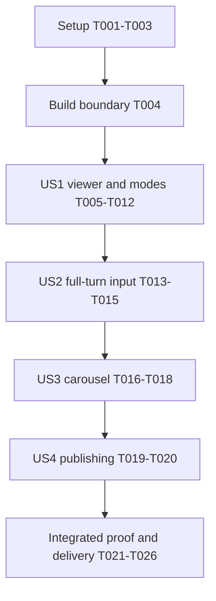

# Tasks: Textured 3D Model Carousel

**Feature**: `002-gltf-model-carousel` | **Generated**: 2026-10-28

**Input**: [spec.md](spec.md), [plan.md](plan.md), [research.md](research.md), [data-model.md](data-model.md), [UI contracts](contracts/components.md), [asset contract](contracts/model-assets.md), and [verification guide](quickstart.md).

**Status**: Task generation complete; all implementation tasks below are pending. No application behavior or new browser acceptance is claimed by this file.

**Current asset state**: `glb/practice_axeTexture.glb` is present and the former model folder is absent at task-generation time. The owner has completed the rename. Do not create a redundant rename task, old-folder fallback, compatibility alias, or another portfolio model. Prior Khronos structural validation is recorded in the design documents; it is not visual acceptance.

**Organization**: Setup → shared build boundary → US1 modes/viewer (P1) → US2 rotation (P1) → US3 browsing (P1) → US4 owner publishing (P2) → integrated verification/delivery. Story IDs/priorities match the specification. Basic discovery is shared infrastructure needed to load the real production model; US4 completes catalog metadata boundaries and proves the owner-facing add/remove workflow, rather than introducing a second catalog convention.

**Verification policy**: Use actual browser/dev/production-preview scenarios, not a new permanent test framework. No permanent automated tests were requested. Run the application type-check and normal production build once after integration; the isolated nested-base build is a separate required deployment scenario, not a repeat of the same check. Do not run build/lint/formatters after each task. Temporary harnesses, distinct models, corrupt fixtures, and instrumentation are never production work; remove only your own temporary artifacts after their smoke evidence is captured. Do not rerun the previously successful GLB validator merely to reconfirm it.

**Format**: `- [ ] T### [P?] [US#?] Action with exact paths`. `[P]` means different output files and independently runnable after the named prerequisites; it never bypasses shared-file ownership or a browser checkpoint.

## Phase 1: Setup

**Goal**: Reuse the current application and saved Figma exports without installing another renderer framework or fetching rate-limited design metadata unnecessarily.

- [ ] T001 Map available language-server references for exported `Project` and `projects` before contract edits in `src/types/project.ts`, `src/data/projects.ts`, `src/components/ProjectCarousel.tsx`, and `src/pages/PortfolioPage.tsx`; inspect `glb/practice_axeTexture.glb` and the saved `specs/002-gltf-model-carousel/design/` inventory without modifying owner assets, repeating structural validation, or renaming the already-correct folder.
- [ ] T002 Add runtime `three` 0.186.1 and development `@types/three` 0.186.0 plus compatible Node build-config types in `package.json`, resolve/install into `package-lock.json`, and preserve the existing React/Vite/Tailwind versions and scripts; no React Three Fiber, Drei, controls library, carousel library, HDR download, test framework, or scaffold replacement.
- [ ] T003 [P] Prepare outlined production artwork in `src/assets/figma/view-clay.svg`, `src/assets/figma/view-rendered.svg`, `src/assets/figma/view-wireframe.svg`, `src/assets/figma/navigation-default.svg`, and `src/assets/figma/navigation-hover.svg` from the corresponding saved vectors in `specs/002-gltf-model-carousel/design/`; retain exact glyph geometry/proportions and enable separate glyph/highlight layers for difference blending without adding an unverified font dependency (after T001; may overlap T002).

**Checkpoint**: Dependencies and real saved artwork are ready; original portfolio/background source remains intact. An unfilled constitution template does not impose additional governance.

## Phase 2: Foundational Build Boundary

**Goal**: Expose one deterministic readonly catalog snapshot and byte-preserving static models to all story implementations.

- [ ] T004 Implement `publicDir: 'glb'` and recursive regular-file discovery in `vite.config.ts`, injecting `__MODEL_PATHS__` through `JSON.stringify`, with a `readonly string[]` declaration in `src/vite-env.d.ts`; scan only the new root, normalize POSIX relative paths, sort case-sensitively by code units, ignore directory symlinks/non-`.glb` entries, handle missing/empty root as empty, and add no old-root fallback, generated tracked manifest, copy plugin, or model payload imports (after T002).

**Checkpoint**: Shared configuration supports both dev-start and production-build snapshots. Source assets map to the public site root, not a `/glb/` URL prefix. No manual production project list is introduced while completing the later stories.

## Phase 3: User Story 1 — Inspect a Model in Three Display Modes (P1)

**Goal**: Deliver the real supplied model, authored materials and showcase lighting, reversible display modes, and the updated Figma mode controls in the actual carousel media area.

**Independent check**: With the supplied single GLB, open the real page or an isolated viewer entry and switch Rendered → Clay → Wireframe → Rendered using pointer, keyboard, and touch. Inspect initial framing, authored appearance/restoration, no filled Wireframe surface, loading/errors, exact mode controls, and no refetch/context recreation. Noninitial-pose/full-side inspection is completed through US2 and final acceptance, not falsely claimed before input exists.

- [ ] T005 [US1] Replace image-specific `Project` fields in `src/types/project.ts` with readonly `id`, `title`, `modelUrl`, and optional `description`, and derive `projects` in `src/data/projects.ts` from `__MODEL_PATHS__` with relative-path IDs, filename titles, per-segment URL encoding below `import.meta.env.BASE_URL`, and axe-only supplied copy for `practice_axeTexture.glb`; no hard-coded membership, title-image dependency, fabricated descriptions, or deprecated image aliases (after T004; integrate all consumers in T011 before the browser checkpoint).
- [ ] T006 [US1] Implement the persistent runtime entry and typed `ModelViewerController`, `ViewerStatus`, and `DisplayMode` contracts in `src/lib/model-viewer.ts`; create a transparent WebGL 2 renderer with sRGB output/Neutral tone mapping, fixed 35-degree camera, initialized RectAreaLight uniforms and shared key/fill/rim rig, rotation/normalization wrappers, sphere-safe fitting, displayed-size ResizeObserver handling including root zoom/zero size, capped pixel ratio, and one coalesced demand RAF rather than an animation loop (after T005).
- [ ] T007 [US1] Implement `select` and idempotent ownership/disposal in `src/lib/model-viewer.ts`: abortable binary fetch, GLB 2.0 container checks, `parseAsync` with pre-dependency self-contained buffer/image checks, embedded-only parse URLs, manager decode-error tracking, model-tagged status/generation guards, valid finite bounds, successful first draw before ready, disabled loaded lights/camera override, no animation playback, and disposal of partial/stale results, original resources, unique ImageBitmaps, listeners/observer/RAF/context without touching the background (after T006).
- [ ] T008 [US1] Implement `setMode` in `src/lib/model-viewer.ts` using null scene override for Rendered, lazy reusable neutral rough/nonmetallic/unmapped MeshStandardMaterial for Clay, and lazy reusable unlit light MeshBasicMaterial with `wireframe: true` for edges-only Wireframe; retain desired mode across selection, preserve original material assignments/geometry/framing/orientation, do nothing on same-mode calls, invalidate one frame on change, and dispose overrides only with their owning runtime (after T007).
- [ ] T009 [P] [US1] Implement `src/components/ViewModeControls.tsx` and its scoped rules in `src/styles.css`: one named native button group, Clay/Rendered/Wireframe order, type-only DisplayMode import, exactly one `aria-pressed`, outlined labels, persistent selected underline, isolated paper-bar/difference hover, focus equivalent plus ring, native activation/focus retention, disabled state, and wrapping/stacking without clipped labels; use the measured Figma row/slots before application zoom, without invented bevel/shadow/animation timing (after T003 and T006; may overlap T007–T008).
- [ ] T010 [US1] Implement `src/components/ModelViewer.tsx` with a named focusable canvas, linked visible instructions, current-model loading/error status, one lifetime effect for runtime ownership, separate selection/mode effects, Rendered initial coarse mode state retained across model prop changes, disabled mode controls until current-model ready, renderer/context initialization failure handling, and the mode group below media and before description; no orientation/frame state or keyed-per-model renderer (after T007–T009).
- [ ] T011 [US1] Cut over `src/components/ProjectCarousel.tsx` to a module-scope lazy `ModelViewer` with local Suspense/module-error handling, generated visible filename title, conditional description, and natural title/media/mode-row/description sizing; migrate every T001-discovered consumer of `Project`/`projects` in the same integration, remove obsolete static-image/title imports and confirmed-unreferenced cutover assets only, retain the existing page composition/active-index navigation boundary, and mount no renderer for empty input (after T005 and T010).
- [ ] T012 [US1] Launch the actual development page and, if needed, a disposable `viewer-preview.html`/`src/dev/viewer-preview.tsx` harness for `src/components/ModelViewer.tsx`; exercise initial real-axe materials, key/fill/rim contributions, three mode appearances/restoration, native button activation, ten mode switches without new GLB requests/contexts, pending-load and decode-error states, and desktop/mobile mode-row appearance against saved Figma vectors per `specs/002-gltf-model-carousel/quickstart.md` sections 1/6; fix owning code before recording this checkpoint, and remove the temporary harness after its evidence is captured (after T011).

**Checkpoint**: Real single-model presentation/modes are usable. US1 is the first useful demonstration checkpoint, not permission to omit rotation, multi-model browsing, publishing boundaries, or final acceptance. Source material preservation applies to Rendered; requested non-Rendered inspection is not an error fallback.

## Phase 4: User Story 2 — Inspect Every Side With Unrestricted Rotation (P1)

**Goal**: Full repeated turns about both axes by pointer, touch, and keyboard without pole clamps, forced upright resets, or accidental carousel activation.

**Independent check**: On one ready model, complete two turns in each direction on each axis with all three input methods, verify inversion and release/cancellation, and change modes at a noninitial pose without changing that pose.

- [ ] T013 [US2] Implement runtime yaw/pitch and reusable quaternion composition `qX(pitch) × qY(yaw)` in `src/lib/model-viewer.ts`, with unrestricted/repeated/reversible turns, one primary Pointer Events drag/capture, displayed-width/height full-turn sensitivity accounting for root zoom, focused arrows at 5 degrees per keydown/repeat, scoped handled-key default prevention, and cancellation on release/cancel/capture loss/window blur/selection/disposal; keep lights/camera fixed and allocate no per-event Three scratch objects (after T012).
- [ ] T014 [US2] Complete input semantics/instructions in `src/components/ModelViewer.tsx` and canvas-only touch/focus rules in `src/styles.css`; retain normal Tab/Shift+Tab exit, outside-viewer scrolling, native Enter/Space on buttons, secondary-pointer rejection, and no rotation-dependent React re-render/status announcements (after T013; coordinate shared styles with T009).
- [ ] T015 [US2] Exercise `src/components/ModelViewer.tsx` with the supplied model and an asymmetric disposable textured GLB if needed: two complete turns each direction/axis using pointer, direct touch emulation, and keyboard; inversion/mixed-axis control, regrabbing, all cancellation paths, unchanged mode/pose on mode switches, camera fitting after resize, outside scrolling, and keyboard exit at 1280 × 832/375 × 812 per `specs/002-gltf-model-carousel/quickstart.md` sections 1/2/6; record device/emulation limits and remove only the temporary fixture/harness after evidence (after T014).

**Checkpoint**: Rotation works in all modes, preserves the material-mode contract, and does not change navigation selection. No OrbitControls clamp workaround, autoplay, wheel zoom, pan, or roll UI.

## Phase 5: User Story 3 — Browse the Model Carousel (P1)

**Goal**: Updated Figma navigation with coherent model/title/copy/status, correct wrap/disabled behavior, retained mode, and selection-safe asynchronous work.

**Independent check**: Feed three distinct complete temporary models to the carousel; click and keyboard through both wrap boundaries, rotate/navigate/revisit, and trigger ten selections during out-of-order loads. Exercise zero/one/error selections independently.

- [ ] T016 [US3] Apply the updated NextButton default/hover artwork to both directions in `src/components/ProjectCarousel.tsx` and `src/styles.css`, mirroring the previous instance while preserving native accessible names, 44-pixel minimum navigation hit targets, functional wrapping, focus retention, stable maximum glyph footprint, the narrower source hover bar/difference blend, keyboard focus equivalent, and non-actionable disabled treatment; retire old arrow imports only after the new direction-safe treatment is in use (after T003 and T012; default sequence waits for T015).
- [ ] T017 [US3] Complete selection-state integration across `src/components/ProjectCarousel.tsx`, `src/components/ModelViewer.tsx`, and `src/lib/model-viewer.ts`: explicit empty card, disabled zero/one navigation, coherent generated title/optional copy/position status, loading/error without stale-ready content, reset fitted orientation/cancel drag on selection, retained latest mode and renderer, navigation away from failures, and generation-safe out-of-order completion including revisits; retain readonly collection-per-instance behavior (after T015–T016).
- [ ] T018 [US3] Exercise `src/components/ProjectCarousel.tsx` through a disposable `viewer-preview.html`/`src/dev/viewer-preview.tsx` harness with three distinguishable complete models: pointer/Enter/Space wrapping/focus, exactly matching content/status, zero/one/error cases, updated hover enter/leave without activation/layout shift, ten rapid selections with delayed/reordered binary responses, retained mode and reset orientation on revisit, and one persistent viewer; use `specs/002-gltf-model-carousel/quickstart.md` sections 3/6 and remove only temporary artifacts after recording observations (after T017).

**Checkpoint**: Browsing is safe and usable without fabricating production projects. Disabled navigation for the real single model must not disable its healthy mode controls.

## Phase 6: User Story 4 — Publish Models by Adding Files to One Folder (P2)

**Goal**: Owner-managed binary files automatically become coherent, identifiable, deployable carousel entries without project-list, component, or mandatory metadata edits.

**Independent check**: In a disposable source-tree copy, add two distinct complete `.glb` files, one nested, restart, browse, remove one, and restart again. Confirm exact membership/order, duplicate-basename identities, encoded filenames, and no external model resource requests.

- [ ] T019 [P] [US4] Finish owner-facing catalog boundary handling in `src/data/projects.ts`: distinguish duplicate basenames with parent context, keep relative-path IDs stable, encode each URL segment without encoding separators or prepending `/glb/`, preserve locale-independent scanner order, derive titles without title SVGs, and associate existing axe description only with exact `practice_axeTexture.glb`; no required metadata or handwritten registration (after T005 and T012; may overlap T013 in its separate runtime file).
- [ ] T020 [US4] Run the add/remove/restart scenario against `vite.config.ts`, `src/data/projects.ts`, and a disposable `glb/` tree using `specs/002-gltf-model-carousel/quickstart.md` section 4: absent/empty root, two distinct models including nested/spaced/duplicate-basename paths, repeat-start ordering, removal to one entry, ignored `.gltf`/`.bin`/images and directory symlinks, malformed `.glb` retained as an error entry, no old-root fallback, no application/registration edits, and textured browsing with zero sidecar requests; never remove/rename the owner's real model to manufacture empty cases (after T018–T019; production/nested-base copying is completed in T022–T024).

**Checkpoint**: The automatic publishing workflow is complete in development. The old folder is neither scanned nor a fallback. Required production-copy and nested-base proof remains in the final phase, not an unobserved claim.

## Phase 7: Integrated Verification and Delivery

**Goal**: Prove the complete feature in the real page and built static output, then update documentation from measured evidence. Every story above is required for completion.

- [ ] T021 Exercise integrated failure/lifecycle/background cases for `src/components/ModelViewer.tsx`, `src/lib/model-viewer.ts`, `src/components/ProjectCarousel.tsx`, and unchanged `src/components/MetaballBackground.tsx` per `specs/002-gltf-model-carousel/quickstart.md` sections 5/6: corrupt/truncated GLB, bad embedded geometry/image, external-reference rejection without requests, invalid bounds, module/WebGL initialization failure, context loss, navigation from errors, ten switches and Strict Mode/unmount/remount cleanup, once-owned override disposal, no idle viewer RAF, pointer/reduced-motion background behavior, transparent wrappers, body isolation, and unchanged 125% scale; fix defects and remove temporary instrumentation after proof, without editing `ascii-metaballs.js` (after T015, T018, T020).
- [ ] T022 Run `npm run typecheck` and `npm run build` once against final integrated `package.json`/`vite.config.ts`, observe successful output or fix actionable failures, and launch the actual `dist/` through `npm run preview -- --host 127.0.0.1`; inspect that the normal output includes unchanged `glb/practice_axeTexture.glb` bytes at the public-root model location and that no temporary fixtures ship (after T021).
- [ ] T023 Inspect the actual production preview for `src/pages/PortfolioPage.tsx` at 1280 × 832 and 375 × 812 per `specs/002-gltf-model-carousel/quickstart.md`: real axe appearance and shared light tuning in Rendered/Clay, edges-only Wireframe, full rotations, exact material restoration, updated navigation/mode default-hover-focus-selected states, single-item navigation/mode independence, loaded local artwork/font, no unexpected console/network errors or horizontal overflow, and preserved background; capture actual desktop/mobile evidence under `specs/002-gltf-model-carousel/evidence/`, not Figma substitutes (after T022).
- [ ] T024 Build and preview a separate disposable source/output copy with the same `vite.config.ts` and `--base=/portfolio/`, using a separate port and complete distinct nested/space-named GLBs in its `glb/`; verify generated membership, public URLs below the nested base without an added `/glb/`, unchanged copied bytes, embedded textures, and zero sidecar requests using `specs/002-gltf-model-carousel/quickstart.md` section 4, then remove only that isolated copy/output; do not change the real root-base config or overwrite its verified `dist/` (after T023).
- [ ] T025 After smoke proof, update `README.md`, `AGENTS.md`, `specs/001-react-portfolio/contracts/components.md`, `specs/001-react-portfolio/data-model.md`, and historical notes in `specs/001-react-portfolio/quickstart.md` for the completed model-backed cutover: `glb/` folder/start-rebuild workflow, self-contained packaging, generated titles, mode defaults/retention, input, updated hover states, empty/error behavior, and healthy two-canvas page expectation; keep old screenshots/results explicitly historical and do not introduce compatibility fields or alter unrelated heading/background contracts (after T023–T024).
- [ ] T026 Record only exercised commands, scenario outcomes, actual screenshots, deliberate fixture failures, device/emulation/accessibility limits, and any genuine blockers in `specs/002-gltf-model-carousel/quickstart.md`; reconcile implemented status in `specs/002-gltf-model-carousel/spec.md` and `specs/002-gltf-model-carousel/plan.md`, and mark `specs/002-gltf-model-carousel/tasks.md` tasks complete only for actual work/evidence satisfying every acceptance criterion (after T025).

## Dependencies and Execution Order

This is the conservative default execution order. Only the named disjoint-file opportunities below may start earlier once their actual prerequisites are complete; the graph does not require idle waiting when such work is ready.

- T001 precedes the setup edits. T002/T003 have disjoint outputs. T004 depends on installed Node build support from T002; all stories use its single catalog snapshot.
- T005 and T011 form one clean producer/consumer cutover before first page acceptance. Temporary intermediate edits are not independently delivered; do not retain old image fields or introduce a hard-coded model list to keep an incomplete stage looking finished.
- T006 → T007 → T008 share `src/lib/model-viewer.ts` and must serialize under one owner. T009 can run after the type contract in T006 is fixed; it does not depend on T007/T008 implementation internals. T010 waits for runtime and controls, then T011 integrates all consumers and T012 proves US1.
- US2 requires US1's actual viewer, not a mock canvas. US3 requires the viewer, complete input cancellation, and existing mode state. Runtime/adapter/style edits spanning these phases remain serialized; no blanket parallelization of stories.
- T019 can start after US1's catalog/consumer cutover while US2 edits its runtime, but T020 waits for complete browsing so its owner workflow is genuinely end-to-end.
- T021 waits for all story checkpoints. T022 is the final normal type-check/build; T023 observes that output. T024 is the distinct nested-base deployment proof in isolation. Documentation/status changes follow successful actual smoke results, not guessed outcomes.
- Browser checkpoint failure means fix the owning code before proceeding; a passed type-check/build alone never completes a visual/interaction criterion. No phase boundary permits dropping remaining required stories.

## Parallel Examples by Story

- **Setup**: After T001, run dependency/lockfile work T002 alongside disjoint SVG asset preparation T003.
- **US1**: After T003/T006, T009 owns only `src/components/ViewModeControls.tsx` and its scoped stylesheet rules while the runtime owner completes T007 then T008 in `src/lib/model-viewer.ts`. T010 waits for both; no concurrent edits to the renderer module.
- **US2**: T013's runtime edit and T014's adapter/style integration are deliberately sequential because the final input behavior must be established first. T019 from US4 is independent metadata work that may overlap T013; do not invent a parallel input task just to fill this example.
- **US3**: T016/T017 share carousel/style/adapter boundaries, and T018 needs the integrated result. Keep them serial. Separate disposable fixture preparation may accompany navigation work, but never edit production model membership or the shared viewer harness concurrently.
- **US4**: T019 may overlap T013 after US1. T020's browser/filesystem workflow runs on its own disposable tree, after browsing is complete; avoid concurrent browser evidence that mutates the same fixture tree. No unnecessary parallel marker on its dependent smoke task.

## Requirement and Acceptance Traceability

| Requirement | Implementation tasks | Observable proof |
| --- | --- | --- |
| FR-001 | T003, T010–T011, T016 | T012, T023: live replacement and revised controls/layout |
| FR-002 | T007, T010 | T012, T021, T023: complete binary/materials, no sidecars or false success |
| FR-003 | T006, T008 | T012, T015, T023: shared key/fill/rim and mode-specific shading |
| FR-004 | T006–T007 | T015, T023: centered fit through rotation/resize |
| FR-005 | T013 | T015, T023: repeated full turns and inversion |
| FR-006 | T013–T014 | T015, T023: pointer/touch/keyboard, focus and scrolling |
| FR-007 | T016–T017 | T018, T023: wrap, zero/one disabled and native activation |
| FR-008 | T007, T010–T011, T017 | T018, T021: coherent selection, revisits and late-load protection |
| FR-009 | T004–T005, T019 | T020, T024: new-root-only add/remove discovery without registration |
| FR-010 | T004–T005, T007, T019 | T020, T022–T024: deterministic order, portable binary URLs, no sidecars |
| FR-011 | T005, T019 | T020: stable distinct identities/titles and axe-only copy |
| FR-012 | T007, T010–T011, T017 | T012, T018, T020–T021: empty/device/model/resource failures |
| FR-013 | T009–T011, T014, T016 | T015, T018, T023: responsive controls, viewer and page |
| FR-014 | T006–T008, T013, T017 | T021, T023: cleanup, persistent renderer and unchanged background |
| FR-015 | T008–T010 | T012, T023: all three modes and correct row/order |
| FR-016 | T008, T010, T017 | T012, T015, T018, T021: reversible/no-refetch modes and retained selection |
| FR-017 | T003, T009, T014, T016–T017 | T012, T018, T023: exact hover/focus/selected/disabled behavior |
| SC-001 | T006–T011 | T015, T023: real textured model, light quality and full framing |
| SC-002 | T013–T014 | T015, T023: two turns per direction/axis for all inputs |
| SC-003 | T007, T016–T017 | T018: three distinct models, wrap and ten out-of-order selections |
| SC-004 | T004–T005, T019 | T020, T022–T024: two/one/empty membership, order, embedded resources |
| SC-005 | T007, T010, T017 | T021: specified failures, remount/lifecycle and preserved background |
| SC-006 | T008–T010, T013, T017 | T012, T015, T018, T021, T023: modes, no refetch and mode retention |
| SC-007 | T003, T009, T014, T016 | T012, T018, T023: both widths and all button states |

## Implementation Strategy and Completion Boundary

1. Complete setup/shared discovery, then integrate and smoke US1 as the first useful checkpoint: the real model with its three modes. This is demonstration sequencing, not a reduced delivery scope.
2. Add US2 input, US3 browsing, and US4 owner publishing in the dependency order above, using only the explicitly safe overlaps. Each adds observable behavior on the same viewer/catalog rather than an alternate mounting path.
3. Finish every integrated failure, lifecycle, responsive, production, and nested-base scenario; update documentation/status only from observed results. All 26 tasks and all 17 functional requirements/seven success criteria remain required for feature completion.
4. No additional pages, editor, persistence service, decoder platform, automatic spin, legacy format/root compatibility, or invented portfolio content. No adopted constitution or extension hooks are present at generation time.
