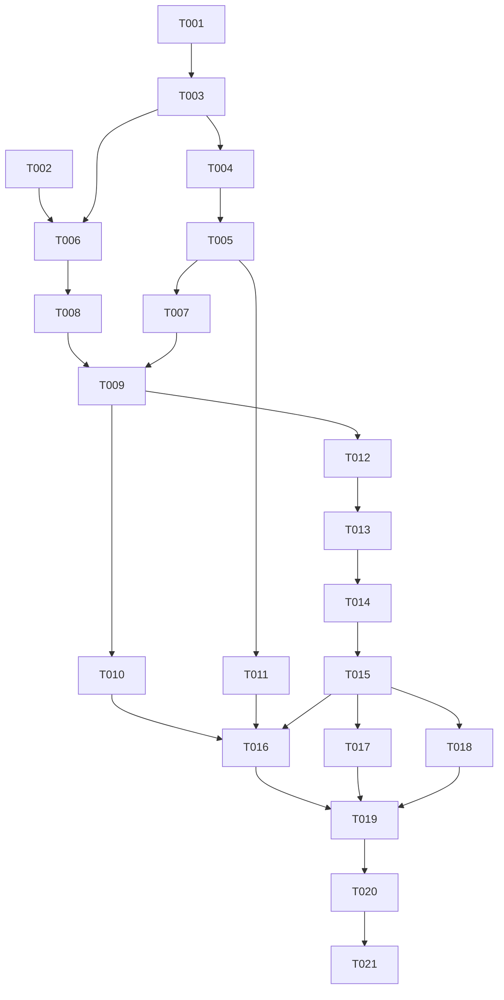

# Tasks: Carousel Interaction Motion Amendment

**Input**: [spec.md](spec.md), [plan.md](plan.md), [research.md](research.md), [data-model.md](data-model.md), [component contracts](contracts/components.md), [quickstart.md](quickstart.md).
**Status**: Amendment implementation is in place. The remaining unchecked tasks cover the full single-model motion verification and final documentation completion; see [quickstart.md](quickstart.md#amendment-evidence--2026-10-30) for actual evidence and limits.
**Format**: `- [ ] Tnnn [P?] [USn?] action with path`. `[P]` identifies work on independent files with no unmet dependencies within that parallel wave. Do not run tests, builds or formatters mid-flight while other editors are working; join each wave first. Preserve owner assets, `ascii-metaballs.js`, one persistent viewer and existing semantic settlement.

## Phase 1: Setup

**Purpose**: Reuse the existing React/Vite/Three.js project and acceptance infrastructure; do not initialize a new app or add dependencies.

- [X] T001 [P] Review the amendment, existing ownership and real acceptance fixtures in `specs/003-carousel-interaction-motion/spec.md`, `specs/003-carousel-interaction-motion/plan.md`, `specs/003-carousel-interaction-motion/data-model.md`, `src/lib/model-viewer.ts` and `tests/acceptance/settlement.spec.ts`; map all `createModelViewer` and exported channel callers using language-server references where available before changing their signatures.
- [X] T002 [P] Inspect Figma ProjectCarousel node `39:205` in file `8Qb17gg8m0JsxFuEScxxsG` and the existing artwork in `src/assets/figma/`; note desktop geometry, navigation stacking, title, viewer, mode row and caption, and identify a responsive adaptation without inventing portfolio content. If Figma is unavailable, use the recorded node geometry in `specs/003-carousel-interaction-motion/research.md` and report the visual limitation.

## Phase 2: Foundational — catalog ownership (blocks both stories)

**Purpose**: Separate loaded-asset lifetime from selection lifetime without changing the one-renderer, one-scheduler and synchronous settlement contracts.

- [X] T003 After T001, thread the stable readonly catalog from `src/components/ProjectCarousel.tsx` through `src/components/ModelViewer.tsx` into `src/lib/model-viewer.ts` once per viewer lifetime; migrate every caller and type together, preserve lazy imports, empty-catalog no-viewer behavior, identity-matched registration and Strict Mode cleanup, and add no compatibility alias.
- [X] T004 After T003, implement a runtime-owned registry keyed by catalog model ID in `src/lib/model-viewer.ts`, with independent loading/ready/failed state, URL, per-entry abort and resource ownership. Start every fetch on viewer startup without waiting for any other load, retain successfully parsed resources until runtime teardown, and do not expose a load result as selected or settled merely because it finished.
- [X] T005 After T004, separate load liveness from `displayed`/`candidate` selection in `src/lib/model-viewer.ts`; retain container/embedded-resource/decode/bounds checks, per-entry generation guards and deduplicated geometry/material/texture/skeleton/ImageBitmap cleanup. Abort pending work on teardown, release noncancelable late parses exactly once and preserve guarded Strict Mode context-loss deferral.

**Checkpoint**: Registry ownership and startup contract are in place; no work outside this feature or extra renderer is introduced. Complete integration and real verification in the story phases before treating the change as usable.

## Phase 3: User Story 1 — Turntable and temporary inspection (P1)

**Goal**: Adopt the full-width Figma viewing surface while preserving automatic rotation, unrestricted inspection, saved-pose return, modes and accessibility.

**Independent test**: With one asymmetric textured model at 1280 × 832 and 375 × 812, inspect the full-width canvas and controls; observe a 24 ±1 second turntable revolution, manual full turns, both pointer/keyboard ownership orders, saved-pose return within 1° and 0.5 seconds of visible time, regrab, suspension and reduced motion. Verify actual native focus and pointer behavior; a single model requires no navigation transition.

- [X] T006 [P] [US1] After T002 and T003, restructure `src/components/ProjectCarousel.tsx` and `src/components/ModelViewer.tsx` so the actual canvas stage spans the carousel width underneath separately focusable native navigation controls; preserve the title, canvas instructions, mode controls, caption, curtain bridge, live region, zero/one disabling and error semantics.
- [X] T007 [P] [US1] After T003–T005, adapt `src/lib/model-viewer.ts` initial selection to consume the initial registry entry as soon as its own load and metadata proof are ready, regardless of other entries, preserving isolated first-draw validation, synchronous finalization, turntable, manual pose ownership, mode overrides and terminal renderer errors. Coordinate the stable viewer interface with T006; do not edit its component files.
- [X] T008 [US1] After T006, implement the Figma `39:205` layout in `src/styles.css`: full-width measurable stage and transparent canvas, navigation overlay above the canvas, centered title and modes, description below, and responsive mobile spacing. Preserve native button hit targets, canvas dragging/touch action, pointer-only outline suppression, keyboard focus ring, local hover/mode artwork, background transparency and no page-level overflow.
- [X] T009 [US1] After T007–T008, adjust `src/lib/model-viewer.ts` resize/projection and input measurements for the real expanded canvas bounds and existing 125% root zoom; maintain drawing-buffer/DPR correctness, fitted rotating models, unrestricted full turns, independent pointer/keyboard tokens, 350 ms shortest-axis return, visible-time pause/resume and reduced-motion behavior without CSS-stretching the bitmap or moving UI with the model.
- [ ] T010 [US1] After T009, exercise the actual single-model surface using `specs/003-carousel-interaction-motion/quickstart.md` at both viewports: compare the Figma layout, actual canvas bounds, drag/focus and modes; measure the revolution and five mixed-input return cycles including regrab, hidden pause and reduced motion. Record real observations, device limits and captures in `specs/003-carousel-interaction-motion/quickstart.md` and `specs/003-carousel-interaction-motion/evidence/` without claiming unexercised physical touch or accessibility audio.

**Checkpoint**: US1 is independently demonstrable on one model; the multi-model startup, failure and navigation requirements of US2 remain mandatory for completion.

## Phase 4: User Story 2 — Directional browsing and synchronized settlement (P1)

**Goal**: Load every catalog model at startup, isolate failures, draw only participating models, retain directional slide/scale and settle matching accessible metadata.

**Independent test**: Mount the real three-fixture catalog at both widths. Hold one noninitial request, verify all loads begin and the initial model settles before release; fail initial and noninitial entries separately and navigate to a healthy entry. Observe both directions and wrap, correct model participation and matching metadata, and verify delayed-details synchronization and native activation-to-compositor settlement.

### Required automated acceptance

- [X] T011 [P] [US2] After T005, update the existing SC-008 delayed-details acceptance in `tests/acceptance/settlement.spec.ts` for startup preload: retain actual per-ticket metadata holds over 500 ms, both directions and widths, supersession/revisit, reduced motion, zero mismatched model/details frames, no early success announcement and exactly one matching settlement. Preserve genuine compositor/DOM evidence and adapt any existing contract assertions broken by preloading; do not replace behavior checks with mock echoes or source-text assertions. This test-file branch may run alongside T006–T009, but joins before T016.

### Implementation and independent proof

- [X] T012 [US2] After T005 and T009, change selection handling in `src/lib/model-viewer.ts` to select pending, ready or failed registry entries without refetching; keep load ownership independent of latest request ID, do not abort catalog loads when selection is superseded, isolate background failure, and route a selected failed entry through the destination-named error path while healthy entries remain navigable.
- [X] T013 [US2] After T012, update presentation and mode handling in `src/lib/model-viewer.ts` so only the selected model draws at rest and only outgoing/incoming draw during transition; hide rather than dispose the outgoing asset after settlement, retain resources for revisits, reset destination pose, retain selected mode and preserve isolated preflight restore before paint. Distinguish preflight draws from presented frames.
- [X] T014 [US2] After T013, preserve Next/Previous direction and wrapping, smoothstep scale 0.72 ↔ 1, aspect-derived travel, actual activation timestamp and adaptive settlement budget in `src/lib/model-viewer.ts`; keep motion paused/resumed without a jump, metadata proof gated, busy input rejected without queueing, and reduced-motion transitions immediate only after valid draw and current proof.
- [X] T015 [US2] After T014, reconcile `src/components/ProjectCarousel.tsx`, `src/components/CarouselMetadata.tsx` and `src/components/ModelViewer.tsx` with pending/failed/ready registry selection: curtain details before accepted navigation, keep loading/error destination names and focus correct, reveal matching actual details only after final centered draw, and update the independent position live region exactly once per successful current request.
- [X] T016 [US2] After T010, T011 and T015, run `npm run test:acceptance` using `tests/acceptance/settlement.spec.ts` and `playwright.config.ts`; inspect real compositor/DOM/accessibility evidence for normal <=500 ms activation-to-presented settlement and the required separately delayed SC-008 scenarios at both widths. Repair genuine implementation or existing contract-test failures; never widen timing, mock rendering or label organic slowness deliberately delayed. Record actual results in `specs/003-carousel-interaction-motion/quickstart.md`.
- [X] T017 [US2] After T015, exercise the actual three-model surface using `tests/acceptance/harness.tsx`, `tests/support/fixtures/` and `specs/003-carousel-interaction-motion/quickstart.md`: intercept startup requests to hold B while A settles and all A/B/C requests have started; release B without navigating, then independently fail B and A and prove other models load, selected failures are identified and onward navigation succeeds without reload. Check revisits do not refetch and superseded load completions cannot settle stale tickets; use disposable observation rather than permanent tests not requested by the spec.
- [X] T018 [US2] After T015, observe actual model draw participation and browser pixels using `tests/acceptance/harness.tsx` and `specs/003-carousel-interaction-motion/quickstart.md`: verify only the selected model draws at rest and only outgoing/incoming during Next/Previous including wraps, with preflight probes recorded separately. Verify overlaid button clicks, pointer drag, keyboard focus, mode retention and no overflow at both widths; remove disposable instrumentation after proof.

**Checkpoint**: Both stories, actual startup/failure/draw evidence and required automated delayed-details acceptance pass. Historic evidence is not an amendment pass.

## Phase 5: Polish and cross-cutting concerns

- [X] T019 After T016–T018, exercise context loss, fetch/decode/first-draw failures, rapid supersession, unmount/Strict Mode replay and late parse/resource disposal in `src/lib/model-viewer.ts` using `specs/003-carousel-interaction-motion/quickstart.md`; verify one viewer plus background canvas, original materials/textures, external-URI rejection and that hidden retained entries are not mistaken for freed memory. Record observed limits and remove disposable scaffolding.
- [X] T020 After T019, run `npm run typecheck`, `npm run build` and actual `npm run preview -- --host 127.0.0.1`; exercise the owner model at both widths and inspect `dist/` to confirm no acceptance fixtures, probes or harness branches ship. Verify isolated nested-base publishing and unchanged asset bytes using `specs/002-gltf-model-carousel/contracts/model-assets.md` and `specs/003-carousel-interaction-motion/quickstart.md`; record only exercised results.
- [ ] T021 After T020, update `README.md`, `AGENTS.md`, `specs/003-carousel-interaction-motion/spec.md`, `specs/003-carousel-interaction-motion/plan.md`, `specs/003-carousel-interaction-motion/data-model.md`, `specs/003-carousel-interaction-motion/contracts/components.md` and `specs/003-carousel-interaction-motion/quickstart.md` to reflect the implemented amendment and actual evidence; reconcile superseded single-resident/loading clauses in feature 002 docs as appropriate and retain historical captures. Mark completed only after full proof.

## Dependencies and execution order

T006 and T007 are independent component/runtime branches after their prerequisites; T011 edits the acceptance test file independently. T008 follows component markup; T009 joins runtime and layout. T012–T015 are sequential because they touch shared runtime and settlement interfaces. T016–T018 are distinct verification scenarios, but use one browser/evidence owner and execute sequentially to avoid shared harness, server or evidence conflicts. Both stories must pass before cross-cutting verification.

## Parallel examples by story

- **US1**: After T003–T005 and T002, T006 owns `src/components/ProjectCarousel.tsx` and `src/components/ModelViewer.tsx`; T007 owns `src/lib/model-viewer.ts`. Join before T009; T008 follows T006 in `src/styles.css`.
- **US2**: T011 owns `tests/acceptance/settlement.spec.ts` while the US1 component/runtime branches proceed. Join it with T015 before running T016; shared runtime implementation T012–T014 stays sequential.

## Requirement coverage

| Requirements | Tasks |
| --- | --- |
| FR-001–004, FR-007, FR-009, SC-001–002/005–006: turntable, input, return, modes and reduced motion | T007–T010, T014, T019 |
| FR-005–008, FR-012–013, SC-003–004/008: movement, failures, finalization and delayed details | T011–T018 |
| FR-010–011, FR-014, SC-007/010: responsive Figma layout, full-width canvas, inherited boundaries | T002, T006, T008–T010, T014, T018–T020 |
| FR-015–016, SC-009–010: all-model startup, isolation and nonparticipating draw suppression | T003–T005, T007, T012–T013, T017–T019 |
| Resource safety, unchanged assets and production publishing | T005, T019–T021 |

## Implementation strategy

Complete setup and foundation, then prove US1 with a single model as the suggested **MVP demonstration**, not as a reduction of the requested feature. Finish US2's multi-model behavior and the explicit delayed-details automated acceptance before integrated verification. No implementation, new tests or runtime acceptance were performed during task generation.
