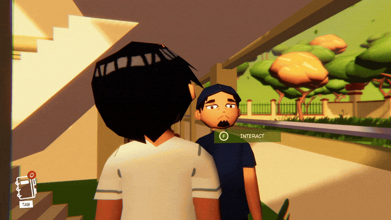
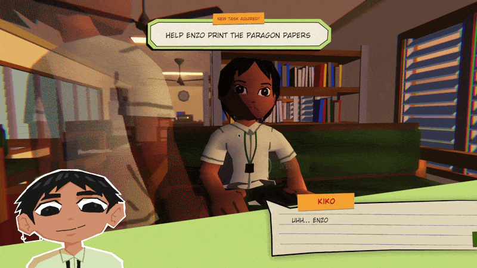
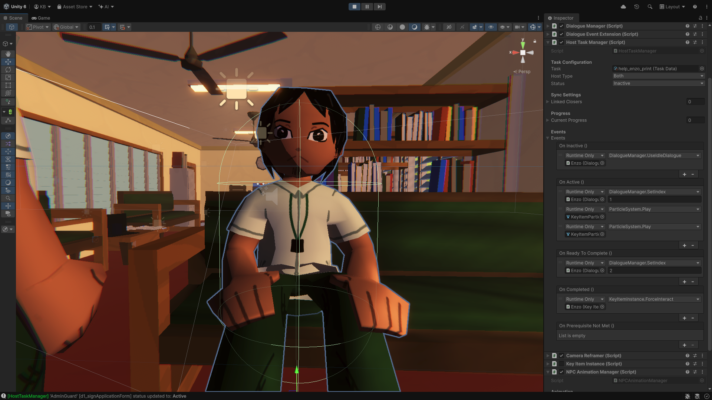

## Overview

KonTEXTo is a narrative-driven educational game that combines 3D campus exploration with document-editing assignments. Players interact with NPCs, complete objectives and receive grading feedback on their work across eight configured narrative days.

As Game Director and Lead Developer, I implemented the player controller, interaction, task, dialogue, level progression and save systems, alongside the document editor and grading system. I collaborated with three teammates on creative direction, objective UI, map integration, level design, narrative, assets, audio, visual effects and testing. This breakdown focuses on the gameplay systems that connect the campus and its assignments.

## Gameplay architecture

The architecture connects player interaction to task progression. ScriptableObjects configure tasks and levels, JSON supplies dialogue content, and scene components maintain runtime state. Serialized UnityEvents coordinate task and dialogue transitions, while C# events notify objective UI and map listeners.

For example, a Day 1 assignment asks the player to help Enzo print publication papers. The task becomes available once its prerequisite is met, requires collecting paper before printing, and ends with an NPC hand-in. The same underlying components support other assignments through different configurations.

## Core gameplay systems

### Universal interaction



`UniversalInteractor` uses a physics proximity scan to select a nearby target. Instead of implementing separate input handlers for NPCs and items, I used an `IInteractable` interface to dispatch interaction to components on the selected object and its children.

```csharp
IInteractable[] interactables = currentClosestInteractable.GetComponentsInChildren<IInteractable>();
foreach (var interactable in interactables)
{
    interactable.Interact();
}
```

*Excerpt from `UniversalInteractor.InteractWithCurrent`.*

This allows an NPC to contain both dialogue and task behavior without requiring a separate interaction script for every NPC. However, invoking multiple components through one input also introduces execution-order concerns.

### Task lifecycle and prerequisites



`TaskData` assets define objectives, required amounts and prerequisites. `HostTaskManager` owns runtime progress and supports Giver, Closer and Both roles, allowing task acceptance and hand-in to occur through different NPCs or the same one.

I separated objective completion from task completion. Meeting all objectives transitions an active task to `ReadyToComplete`; a subsequent validated hand-in marks it `Completed`. Status events coordinate other components, and progress notifications allow the UI to display changes without owning task state.

### Sequential objectives and key items

`KeyItemInstance` checks whether its target task can accept progress before starting an optional interaction delay. `HostTaskManager` validates the report again afterward, checking active status, objective identity and required sequence.

```csharp
bool wasAccepted = targetGiver.ReportProgress(itemKey, 1);

if (wasAccepted)
{
    Retire();
}
```

*Selected lines from `KeyItemInstance.ProcessReport`.*

The acceptance receipt prevents this reporting path from removing an item when its progress is rejected. Revalidation also accounts for task state changing while an interaction is waiting. In a July revision, moving the permission check before the delay addressed misleading wait feedback for invalid interactions; report-time validation already existed.

### NPC dialogue synchronization

`DialogueManager` loads conversations from JSON and selects branches by index. Task status events can change the next branch, while dialogue events can trigger gameplay actions such as task completion.



Enzo's prefab maps Active to conversation index 1 and ReadyToComplete to index 2. Ending the latter conversation invokes task completion. This lets narrative content and task behavior be configured together without hardcoding every conversation into the task manager.

### Level progression and persistence

`LevelTaskTracker` instantiates task prefabs from level configuration and reconstructs their state using saved active and completed task IDs. Completed tasks restore full objective progress and retire explicitly linked items within their spawned prefab. Active tasks restart through `StartTask`, which initializes their counters.

This separates persistent progression from scene-local objects, although individual objective counts are not stored in the inspected level-progress data.

## Technical challenge: synchronizing dialogue and task transitions

During the task/dialogue refactor, I moved task progress toward Giver-centered ownership rather than relying on dialogue-client task state. Adding NPCs that both give and close tasks introduced an ordering concern: the same interaction could change the task status and dialogue index before the intended conversation was selected.

I addressed this by capturing the selected conversation at interaction time and deferring the Both-role task transition by one frame. The current conversation retains its selected branch while status callbacks can update the index for future interactions.

This establishes clearer ownership without requiring dialogue and task logic to merge into one component. It is not a completely centralized state model: dialogue indices and Closer status copies still depend on synchronization. The historical revision introducing Both also introduces the deferral, so this describes the timing concern rather than a reproduced broken-before build.

*Refactor: `b6571e7` · Status events: `87f3a69` · Deferred transition: `9a62d68`.*

## Development diary

A retrospective timeline reconstructed from Git history in 2026:

| Period | Milestone |
| --- | --- |
| Jan–Mar | Player movement, early dialogue and tasks, Giver/Closer roles. |
| Jun | Task/dialogue refactor, status events, deferred transitions and restoration. |
| Jul–Aug | Sequential objectives, interaction validation, project restructuring and narrative content. |
| Sep–Oct | Automatic task activation, dialogue cooldown, progression integration and presentation polish. |

## Retrospective

KonTEXTo highlights how gameplay complexity grows when independently useful systems must remain consistent. Clearer task ownership and explicit validation improved the architecture, but duplicated state, prefab event wiring and restoration side effects remain areas for improvement.

In a future iteration, I would consolidate transition validation, persist objective counts where mid-task continuity is required, and add integration tests for interaction ordering, dialogue bindings and save restoration. These are proposed improvements rather than completed changes.
